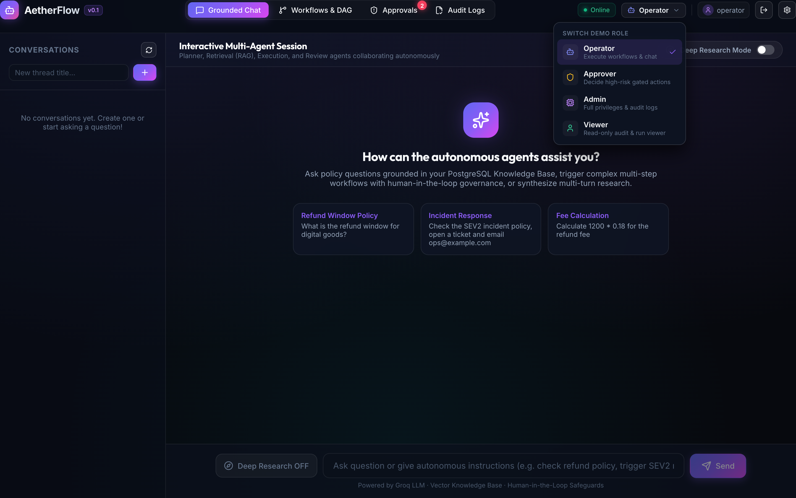
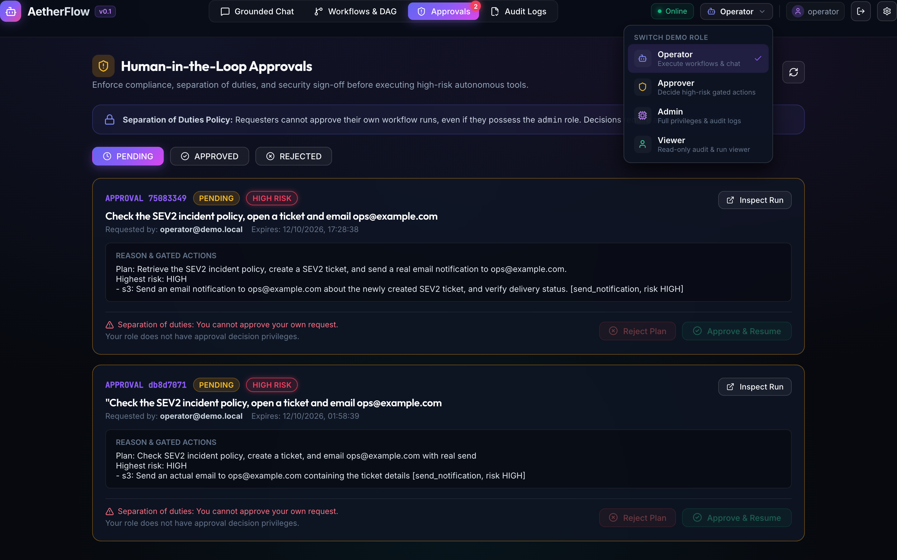
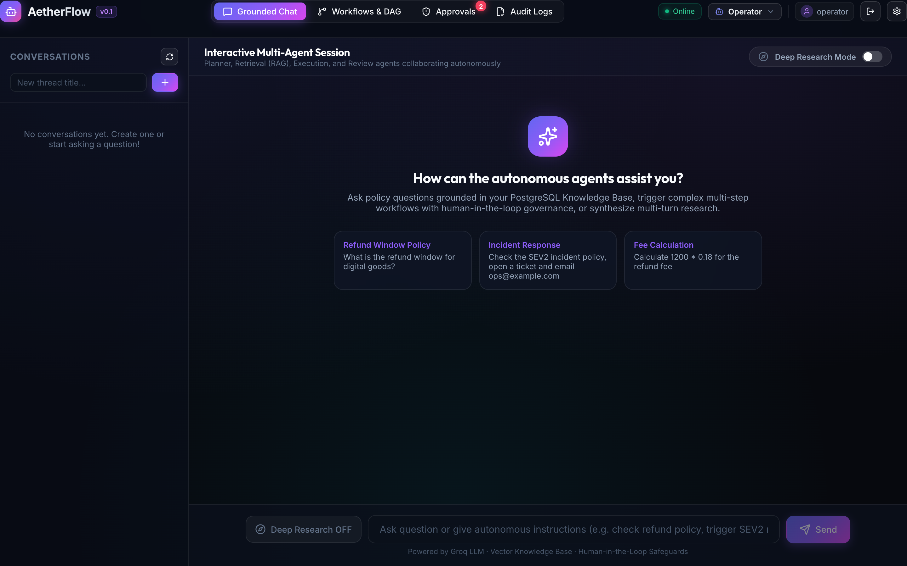
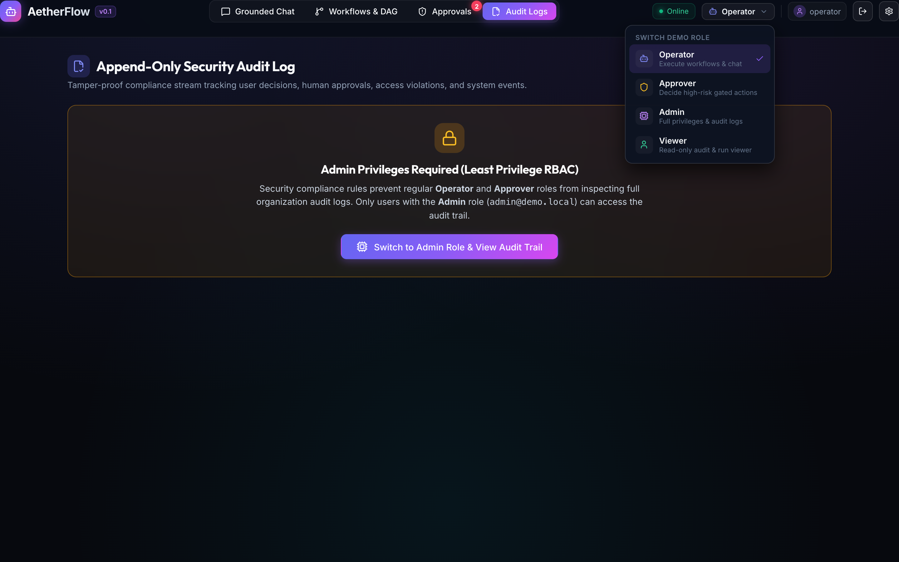

# AetherFlow — Autonomous Multi-Agent Workflow & Governance Platform

<p align="center">
  
  
  
  
  
  
  
  
  
</p>

---

> 🌐 **Live Web Console:** [**https://aether-flow-platform.vercel.app**](https://aether-flow-platform.vercel.app)  
> 📖 **Interactive API Documentation:** Available locally at `http://localhost:8080/docs`

**AetherFlow** is an enterprise-ready, autonomous multi-agent orchestration and workflow governance platform. It provides deterministic Directed Acyclic Graph (DAG) workflow scheduling, dual-agent human-in-the-loop approvals, strict cryptographic auditability, grounded RAG knowledge synthesis, and zero-trust tool execution.

---

## 📸 Platform Interface

<p align="center">
  
</p>

### Console Views

| **Grounded Multi-Agent Assistant** | **Human-in-the-Loop Governance** |
|:---:|:---:|
|  |  |
| *Context-aware agent conversation with knowledge citations* | *Dual-control approval inbox with separation-of-duties* |

| **Authentication & Role Switcher** | **Immutable Audit Logs** |
|:---:|:---:|
|  |  |
| *1-Click demo authentication across 4 RBAC roles* | *Append-only tamper-evident compliance audit trail* |

---

## ⚡ Core Architecture

```
+-----------------------------------------------------------------------------------+
|                                  AetherFlow Platform                              |
+-----------------------------------------------------------------------------------+
|  [ React 19 + TypeScript Console ] (Vercel) / [ Streamlit Admin ] (Port 8501)    |
|                                        │ REST / SSE                               |
|                                        ▼                                          |
|  [ FastAPI Async Core ]                                                           |
|    ├── Security Middleware (Argon2, Pinned JWT, Request ID, Rate Limiter)         |
|    ├── RBAC Enforcement Guard (Admin / Approver / Operator / Viewer)              |
|    └── Zero-Trust Tool Registry (7 Execution Gates, SSRF Shield, Idempotency)    |
|                                        │                                          |
|                                        ▼                                          |
|  [ Multi-Agent Orchestrator (DAG Engine) ]                                        |
|    ├── 1. Planner Agent      -> Schema-checked multi-step execution plan         |
|    ├── 2. Approval Gate      -> Mandatory human approval on HIGH-risk actions     |
|    ├── 3. Retrieval Agent   -> Hybrid keyword + vector cited document search      |
|    ├── 4. Execution Agent   -> Sandboxed deterministic tool runner                |
|    └── 5. Review Agent      -> Independent critic verifying goal achievement      |
|                                        │                                          |
|                                        ▼                                          |
|  [ Persistence & Caching ] PostgreSQL 16 (State Machine, Leases) + Redis 7 Cache  |
+-----------------------------------------------------------------------------------+
```

---

## 🚀 Key Capabilities

- **Autonomous Multi-Agent Pipeline:**
  - **Planner Agent:** Synthesizes validated dependency graphs (DAG) with explicit risk tagging.
  - **Retrieval Agent:** Fuses hybrid lexical and vector search with cryptographic source citations.
  - **Execution Agent:** Deterministically executes approved steps through strict sandboxed tools.
  - **Review Agent:** Independent verification agent scoring correctness, completeness, and safety.
- **Human-in-the-Loop (HITL) Governance:**
  - High-risk operations (such as external notifications or system writes) automatically pause workflow execution.
  - Database-enforced separation-of-duties prevents requesters from approving their own actions.
- **Reliable Distributed State Machine:**
  - Transactional state transitions recorded in PostgreSQL with optimistic locking and distributed worker leases.
  - Automatic crash recovery, exponential backoff with jitter, and dead-letter handling.
  - True idempotency: replayed requests return cached execution outputs without repeating external side effects.
- **Defense-in-Depth Security:**
  - Argon2id password hashing, rotating JWT refresh tokens with family revocation.
  - SSRF-proof HTTP fetcher with IP-level blacklisting and private subnet guards.
  - Automated PII and credential redaction across all stored audit traces and tool logs.
- **Full-Stack Observability:**
  - Prometheus metrics instrumentation across API latencies, agent token usage, and tool durations.
  - Distributed tracing linking end-to-end user workflows to exact LLM token counts and costs.

---

## 🛠️ Quickstart

### Option 1: Live Cloud Console
Open [**https://aether-flow-platform.vercel.app**](https://aether-flow-platform.vercel.app) to explore the web application directly without manual installation.

### Option 2: Docker Compose (Recommended Local Setup)

```bash
# 1. Clone repository
git clone https://github.com/Manishrao07/AetherFlow-Platform.git
cd AetherFlow-Platform

# 2. Start PostgreSQL, Redis, Migrations, FastAPI Backend, and Web UI
docker compose up --build

# 3. Seed demo users and initial documents
make seed

# 4. Run automated end-to-end verification demo
make demo
```

Once running:
- **FastAPI Backend:** `http://localhost:8000` (Docs: `http://localhost:8000/docs`)
- **React Web Console:** `http://localhost:5173` (or `https://aether-flow-platform.vercel.app`)
- **Streamlit Admin Dashboard:** `http://localhost:8501`

---

## 🔑 Demo Credentials

| Role | Email | Password | Permissions & Scope |
|---|---|---|---|
| **Admin** | `admin@demo.local` | `Demo#Pass123` | Full administrative control, user management, audit logs |
| **Approver** | `approver@demo.local` | `Demo#Pass123` | Human-in-the-loop review & approval of high-risk actions |
| **Operator** | `operator@demo.local` | `Demo#Pass123` | Create workflows, trigger agents, run grounded chat |
| **Viewer** | `viewer@demo.local` | `Demo#Pass123` | Read-only inspection of workflows, timelines, and metrics |

---

## ⚙️ Environment Configuration

| Variable | Default | Description |
|---|---|---|
| `DATABASE_URL` | `postgresql+asyncpg://...` | Asynchronous PostgreSQL connection URI |
| `JWT_SECRET` | Required | Cryptographic secret for signing JWT access tokens |
| `ENVIRONMENT` | `development` | Deployment environment (`development` / `test` / `production`) |
| `LLM_PROVIDER` | `mock` | LLM engine (`mock`, `anthropic`, `groq`, `gemini`) |
| `LLM_MODEL` | `-` | Target LLM model name |
| `REDIS_URL` | `redis://localhost:6379/0` | Cache and distributed rate limiting backend |
| `RATE_LIMIT_ENABLED` | `true` | IP-based request throttling guard |

*See [`.env.example`](.env.example) for comprehensive configuration options.*

---

## 🧪 Testing & Verification

AetherFlow maintains rigorous test standards with 100% CI coverage across unit, integration, and end-to-end suites:

```bash
# Run complete test suite with coverage
pytest

# Code formatting and linting checks
ruff check . && ruff format --check .

# Strict type checking
mypy
```

```
✓ 521 unit tests passing
✓ 100% type safety across 129 source modules
✓ CI checks verified on GitHub Actions
```

---

## 📁 Repository Structure

```
AetherFlow-Platform/
├── app/
│   ├── agents/          # Autonomous agents (Planner, Retrieval, Execution, Review)
│   ├── api/             # FastAPI REST endpoints & route controllers
│   ├── core/            # Security, JWT, config, rate limiting, and observability
│   ├── models/          # SQLAlchemy async database models
│   ├── orchestrator/    # DAG execution engine, state machine, worker leases
│   ├── services/        # Business logic, auth, chunking, and memory
│   └── tools/           # Sandboxed tool registry and execution gates
├── frontend/            # Modern React 19 + TypeScript + Vite Web Console
├── ui/                  # Streamlit Administrative and Metrics UI
├── deploy/              # Prometheus and Grafana observability definitions
├── docs/                # Architecture specifications, diagrams, and technical notes
└── tests/               # Unit, integration, e2e, and security test suites
```

---

## 📄 License
This project is licensed under the MIT License.
