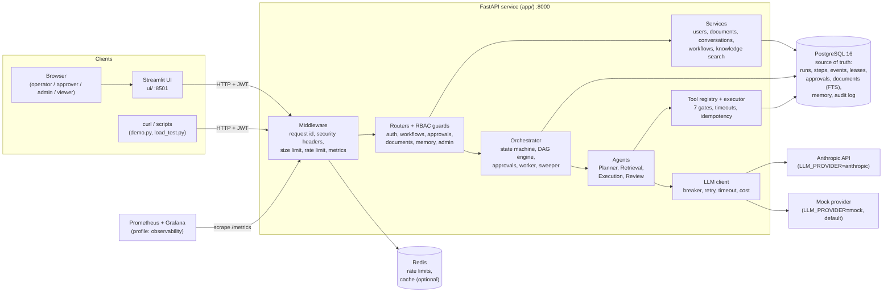
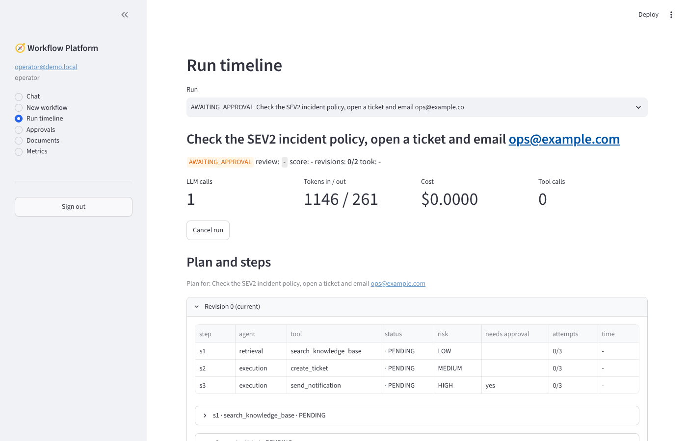
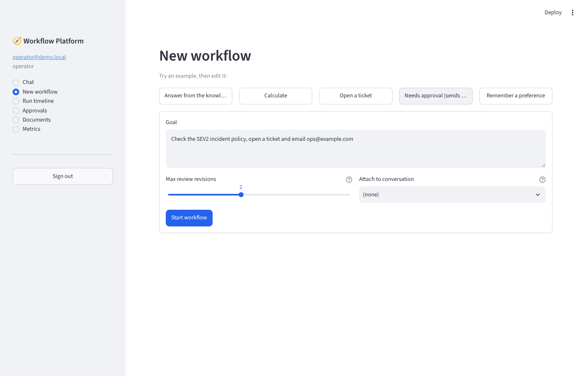
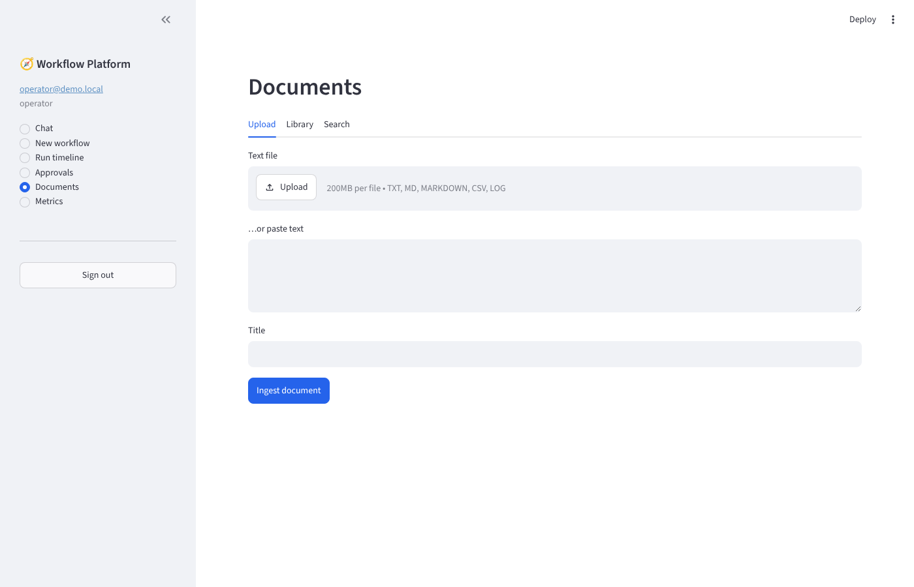
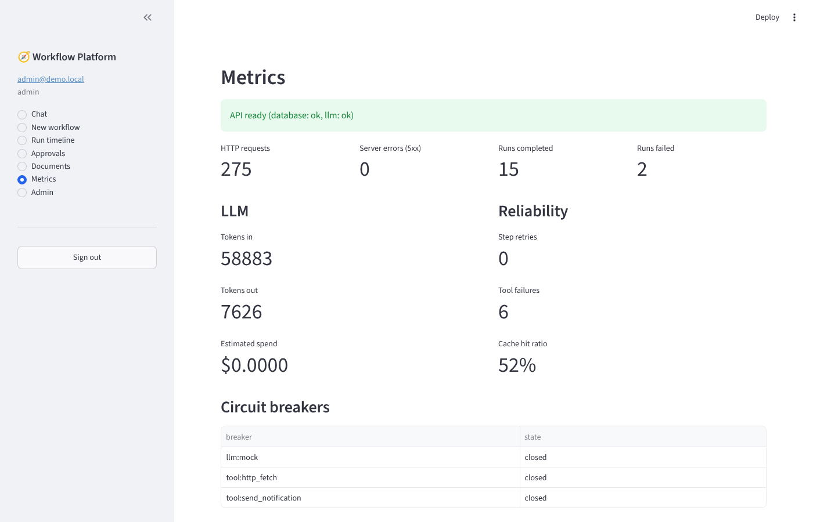

# Multi-Agent Workflow Platform

Planner, Retrieval, Execution and Review agents with tool calling, human approvals, retries,
memory, tracing and conversation management. (Polynomial AI assessment - Project 1.)

> **Status: all 8 phases done.** Everything below is implemented and tested; see
> [docs/RUBRIC_CHECK.md](docs/RUBRIC_CHECK.md) for what was verified, what was not, and the honest gaps.


## Features

- **Multi-agent pipeline:** Planner -> (human approval) -> Execution -> Review, with a Retrieval agent for cited answers from a knowledge base. Plans are validated by code, not trusted from the model.
- **Human in the loop:** HIGH-risk plans pause *before anything runs*; the requester can never approve their own request (API and database constraint).
- **Reliable by design:** explicit state machine in Postgres, events written in the same transaction, DAG execution, retries with jitter, circuit breaker, leases and crash recovery, idempotency keys on every side effect.
- **Safe tools:** seven gates per call, schema validation, timeouts, SSRF-proof `http_fetch`, whitelist-only calculator.
- **Security:** argon2, pinned JWT with refresh rotation and reuse detection, RBAC, append-only audit log, redaction, rate limiting, hardening headers, untrusted text shown literally in the UI.
- **Observable:** Prometheus metrics, tracing (trace id = run id), Grafana dashboard, per-run timeline with tokens and cost.
- **Provider-agnostic LLM:** Anthropic, Groq (OpenAI-compatible, with an optional fallback model) or a deterministic mock (default), so everything runs and is tested with no API key.
- **Deep research mode:** the Planner splits a topic into sub-questions; Research agents answer each one in parallel from your documents, Wikipedia, arXiv and (with a key) the web; a Synthesizer writes a cited report; the Review agent is the critic. Includes a confidence score, PDF/Markdown export, follow-up questions answered from the report, topic comparison and a "you already researched this" suggestion.
- **Hybrid search:** keyword + embedding similarity fused by rank (offline hashing embedder by default; any OpenAI-compatible embeddings endpoint optional).
- **Web UI:** chat, new workflow, live run timeline, approvals inbox, documents, metrics, admin (users + audit log).

## Architecture in one picture



The API is stateless; a worker (in-process or separate) drives each run under a Postgres lease; the
UI is a plain REST client. Details: [architecture](docs/architecture.md) (components, data flow,
threat model, scalability, failure modes, NFR map), [trade-offs](docs/tradeoffs.md),
[deployment diagram](docs/diagrams/deployment.md), [component diagram](docs/diagrams/components.md).

## Prerequisites

- **Docker** with Compose v2 (for `docker compose up --build`); nothing else is needed to run it.
- To develop without Docker: Python 3.11+ and a local PostgreSQL 16 (user/password `wf`/`wf`).
- Optional: an `ANTHROPIC_API_KEY` and `LLM_MODEL` to use a real model (`LLM_PROVIDER=anthropic`).

## Quickstart (3 commands)

```bash
docker compose up --build          # postgres + redis + migrations + API :8000 + web UI :8501
make seed                          # demo users + sample documents (docker compose run --rm api python scripts/seed.py)
make demo                          # guided end-to-end run against the live API (or open http://localhost:8501)
```

No `.env` is needed: compose has safe development defaults. Web UI: <http://localhost:8501>
(sign in with a demo account below). API docs: <http://localhost:8000/docs>. A minute-by-minute
recording script is in [docs/demo-script.md](docs/demo-script.md).

## Demo credentials (created by the seed script)

| Role | Email | Password |
|---|---|---|
| admin | admin@demo.local | `Demo#Pass123` |
| approver | approver@demo.local | `Demo#Pass123` |
| operator | operator@demo.local | `Demo#Pass123` |
| viewer | viewer@demo.local | `Demo#Pass123` |

(Override with `SEED_DEMO_PASSWORD`. The seed script refuses to run when `ENVIRONMENT=production`.)

## Configuration

Read once at startup by `app/core/config.py` and validated - the app refuses to boot on bad config.

| Variable | Default | Notes |
|---|---|---|
| `DATABASE_URL` | required | Must be `postgresql+asyncpg://...` |
| `JWT_SECRET` | required | >= 32 chars; the `change-me...` placeholder is rejected when `ENVIRONMENT=production` |
| `ENVIRONMENT` | `development` | `development` / `test` / `production` |
| `LLM_PROVIDER` | `mock` | `mock` needs no key; `anthropic`, `groq` or `gemini` need `LLM_MODEL` and the matching key |
| `LLM_MODEL` | - | Model name; never hardcoded. Required for `anthropic` |
| `ANTHROPIC_API_KEY` | - | Required for `anthropic` |
| `GROQ_API_KEY`, `GROQ_BASE_URL` | -, `https://api.groq.com/openai/v1` | Required for `LLM_PROVIDER=groq` |
| `GEMINI_API_KEY`, `GEMINI_BASE_URL` | -, `https://generativelanguage.googleapis.com/v1beta/openai` | Required for `LLM_PROVIDER=gemini` (Google's OpenAI-compatible endpoint). Multiple comma-separated keys are supported for load balancing. |
| `LLM_FALLBACK_MODEL` | - | Groq/Gemini only: a second model tried when the first fails with a retryable error |
| `TAVILY_API_KEY` | - | Optional; enables the `web_search` research source (Wikipedia, arXiv and your documents need no key) |
| `TAVILY_BASE_URL`, `WIKIPEDIA_BASE_URL`, `ARXIV_BASE_URL` | public endpoints | Override for proxies or tests |
| `RESEARCH_TIMEOUT_SECONDS`, `RESEARCH_MAX_RESULTS`, `RESEARCH_SNIPPET_CHARS` | 10, 5, 1500 | Limits for each research tool call |
| `DEEP_RESEARCH_MAX_QUESTIONS` | 4 | Sub-questions (= parallel research steps) per deep run, 2-6 |
| `EMBEDDING_PROVIDER` | `hash` | `hash` (offline, no key), `openai` (any OpenAI-compatible `/embeddings`) or `none` (keyword search only) |
| `EMBEDDING_MODEL`, `EMBEDDING_BASE_URL`, `EMBEDDING_API_KEY` | -, OpenAI URL, - | Required model and key for `EMBEDDING_PROVIDER=openai` |
| `SEMANTIC_MIN_SIMILARITY`, `SEMANTIC_MAX_CANDIDATES` | 0.2, 5000 | Noise floor for vector-only hits; chunks compared per search |
| `LLM_TIMEOUT_SECONDS`, `LLM_MAX_ATTEMPTS`, `LLM_RETRY_BASE_DELAY_SECONDS` | 30, 3, 0.5 | Per-call timeout and retry/backoff |
| `LLM_BREAKER_FAILURE_THRESHOLD`, `LLM_BREAKER_RECOVERY_SECONDS` | 5, 30 | Circuit breaker |
| `LLM_INPUT_COST_PER_MTOK`, `LLM_OUTPUT_COST_PER_MTOK` | 0, 0 | USD per million tokens, for cost estimates |
| `HTTP_FETCH_ALLOWED_HOSTS` | `example.com` | Comma separated allow-list for the `http_fetch` tool |
| `HTTP_FETCH_TIMEOUT_SECONDS`, `HTTP_FETCH_MAX_BYTES`, `TOOL_OUTPUT_MAX_CHARS` | 10, 1 MiB, 20000 | Tool limits |
| `MAX_PLAN_STEPS`, `RETRIEVAL_TOP_K` | 10, 5 | Planner output cap; passages per search |
| `REVIEW_MIN_SCORE` | 0.7 | APPROVED verdicts scoring lower are downgraded to NEEDS_REVISION |
| `SHORT_TERM_TOKEN_BUDGET`, `SHORT_TERM_KEEP_RECENT`, `SUMMARY_MAX_TOKENS` | 2000, 6, 300 | Chat-history window |
| `DOCUMENT_MAX_CHARS` | 200000 | Upload size guard |
| `REDIS_URL` | - | Optional; shared rate-limit counters across replicas (in-process fallback when unset) |
| `ACCESS_TOKEN_MINUTES`, `REFRESH_TOKEN_DAYS` | 15, 7 | Token lifetimes |
| `RATE_LIMIT_ENABLED`, `RATE_LIMIT_DEFAULT_PER_MINUTE`, `RATE_LIMIT_AUTH_PER_MINUTE` | true, 300, 10 | Per client IP; auth endpoints get the strict bucket |
| `TRUST_PROXY_HEADERS` | `false` | Honour `X-Forwarded-For` only behind a trusted proxy |
| `WORKER_ENABLED`, `MAX_CONCURRENT_RUNS`, `MAX_PARALLEL_STEPS` | true, 4, 4 | In-process worker switch; runs driven at once; steps in parallel per run |
| `STEP_MAX_ATTEMPTS`, `STEP_RETRY_BASE_DELAY_SECONDS`, `STEP_RETRY_MAX_DELAY_SECONDS` | 3, 0.5, 8 | Step retry policy |
| `DEFAULT_MAX_REVISIONS` | 2 | Review -> re-plan loops before the run fails |
| `APPROVAL_TTL_SECONDS` | 86400 | Pending approvals expire after this |
| `RUN_LEASE_SECONDS`, `SWEEP_INTERVAL_SECONDS`, `SSE_POLL_INTERVAL_SECONDS` | 30, 15, 0.5 | Worker lease, recovery sweep, event stream poll |
| `TRACING_EXPORTER` | `console` | `none` / `console` (one JSON log line per span) / `otlp` (needs `OTLP_ENDPOINT`) |
| `METRICS_TOKEN`, `WORKER_METRICS_PORT` | - | Optional bearer token for `/metrics`; metrics port of a stand-alone worker |
| `CACHE_ENABLED`, `CACHE_MAX_ENTRIES`, `RETRIEVAL_CACHE_TTL_SECONDS` | true, 1000, 60 | Retrieval cache (Redis when `REDIS_URL` is set, otherwise in-process) |
| `LLM_CACHE_ENABLED`, `LLM_CACHE_TTL_SECONDS` | false, 3600 | Cache identical LLM requests (opt-in) |
| `MOCK_LLM_LATENCY_SECONDS` | 0 | Simulated model latency for `LLM_PROVIDER=mock` (demos, load tests) |
| `LOG_LEVEL`, `LOG_JSON` | `INFO`, `true` | JSON logs with request/run/step/user IDs |
| `DB_POOL_SIZE`, `DB_MAX_OVERFLOW`, `DB_CONNECT_RETRIES` | 10, 10, 20 | Pooling and startup retry |
| `CORS_ORIGINS`, `MAX_REQUEST_BYTES` | `http://localhost:8501`, 2 MiB | |
| `API_BASE_URL` *(UI only)* | `http://localhost:8000` | Where the Streamlit UI finds the API (`http://api:8000` in compose) |
| `UI_SHOW_DEMO_HINT` *(UI only)* | `false` | Lists the demo accounts on the sign-in page (compose sets `true`) |

Full list with comments: [`.env.example`](.env.example).

## Running tests

Tests use a real PostgreSQL (the schema relies on tsvector, triggers and partial indexes).

```bash
# Option A - everything in Docker
docker compose --profile test run --rm tests

# Option B - local venv with a Postgres on localhost:5432 (user/pass wf/wf)
pip install -e ".[dev]"
pytest                      # creates the wf_test database, runs Alembic, then the tests
ruff check . && ruff format --check . && mypy
```

Current result: **801 tests passing, ~98% coverage** (gate: 80%).

## API (`/api/v1`)

| Endpoint | Who | Notes |
|---|---|---|
| `POST /auth/register` | public | creates a `viewer` only |
| `POST /auth/login` | public | access (15 min) + refresh (7 d) tokens |
| `POST /auth/refresh` | public | rotates; reusing a used token revokes the user's whole token family |
| `POST /auth/logout` | public | revokes a refresh token |
| `GET /auth/me` | any user | profile + roles |
| `GET /users`, `GET /users/{id}` | admin | paginated (`limit<=100`, `offset`) |
| `PUT /users/{id}/roles`, `PUT /users/{id}/active` | admin | audited; admins cannot lock themselves out |
| `GET /audit-logs` | admin (`audit:read`) | read-only, filters: `action`, `actor_id`, `resource_type` |
| `GET /tools` | any user with `workflow:read` | tool catalogue: schema, risk, approval need, `allowed_for_you` |
| `POST /conversations`, `GET /conversations` | operator+ / any | list is private to you, newest activity first, filter `?status=` |
| `GET /conversations/{id}`, `GET .../messages` | owner | history oldest-first, paginated; someone else's id returns 404 |
| `POST .../messages`, `POST .../archive` | owner (operator+) | archived conversations reject new messages (409) |
| `POST /conversations/{id}/context` | owner (operator+) | the window agents see: rolling summary + recent messages within the token budget |
| `POST /documents` | operator+ | chunk + store text; identical content is a no-op (200 instead of 201) |
| `GET /documents`, `GET /documents/{id}`, `GET /documents/search?q=` | any user | search returns ranked passages with citations |
| `DELETE /documents/{id}` | owner or admin | audited; chunks cascade |
| `GET /memory`, `GET /memory/search?q=`, `PUT /memory/{key}` | you only | long-term memory is private per user; PUT needs operator+ |
| `DELETE /memory/{key}`, `DELETE /memory` | you only | privacy erase (any role, audited) |
| `POST /workflows` | operator+ | starts a run, returns `202` (or `200` with the existing run when the `Idempotency-Key` header repeats). Body: `goal`, optional `conversation_id`, `max_revisions`, `mode` (`standard` or `deep`) |
| `GET /workflows/similar?goal=` | owner | your earlier completed runs on a similar topic (suggestion only) |
| `GET /workflows/{id}/report?format=md\|pdf` | owner / approver / admin | the finished report; `409` until the run completes |
| `POST /workflows/{id}/ask` | operator+ | follow-up question answered from the finished report only |
| `GET /workflows`, `GET /workflows/{id}` | owner / approver / admin | other users get 404; filters `?status=`; paginated |
| `POST /workflows/{id}/cancel` | owner or admin | stops running steps; pending approvals are closed |
| `POST /workflows/{id}/steps/{step_id}/retry` | owner or admin | re-runs one FAILED step of a FAILED run (and the steps skipped because of it) |
| `GET /workflows/{id}/timeline` | owner / approver / admin | steps, tool calls (redacted), LLM calls (tokens, latency, cost), approvals, events, totals |
| `GET /workflows/{id}/events` | owner / approver / admin | Server-Sent Events; resumes from `Last-Event-ID`; ends with an `end` event |
| `GET /approvals`, `GET /approvals/{id}` | approver, admin (requester sees own) | default `?status=PENDING`; shows the goal and the plan the approver is signing off |
| `POST /approvals/{id}/approve`, `.../reject` | approver, admin | not the requester; reject needs a comment; deciding twice returns 409 |
| `GET /healthz`, `GET /readyz` | public | liveness / readiness (`readyz` checks DB and LLM breaker) |
| `GET /metrics` | public in the private network; bearer token if `METRICS_TOKEN` is set | Prometheus text format |

Every error uses `{"error": {"code", "message", "details", "request_id"}}`.
Interactive docs: `/docs`.

## Security model (Phase 2)

- **Passwords:** argon2id; policy = 10+ chars with a letter and a digit.
- **Tokens:** HS256 JWT, algorithm pinned, issuer + type checked (a refresh token can't be used as an access token). **Roles are read from the database on every request**, so a role change or deactivation takes effect immediately.
- **No account enumeration:** unknown email and wrong password return the same 401 and cost the same time.
- **RBAC:** one role-to-permission table (`app/services/permissions.py`); guards are declared per route in the function signature; refused attempts are written to the audit log.
- **Audit log:** append-only (DB trigger), written in its own transaction so failures are recorded even when the request rolls back; secrets redacted before storing.
- **HTTP hardening:** security headers, request-size limit (declared and streamed), CORS allow-list, per-IP rate limiting (strict on auth), generic 500s that never leak internals.
- Sequence diagram: [docs/diagrams/sequence-login.md](docs/diagrams/sequence-login.md)

## LLM layer and tools (Phase 3)

- **Provider-agnostic LLM client** (`app/core/llm/`): Anthropic and a deterministic **mock** (default; no key needed) behind one interface. Protection order: circuit breaker -> retry (exponential backoff + full jitter, honours `Retry-After`) -> hard timeout -> provider. Every attempt is stored in `llm_calls` (tokens, latency, cost, error). Model name and prices come from env, never code.
- **Tool registry** (`app/tools/`): each call must pass seven gates - tool exists, is in the **plan**, is in the **agent's allow-list**, the user's **role** permits it, **input validates** (unknown fields rejected), **human approval** for HIGH risk, then runs under a **timeout** (+ breaker for external tools) with an **output cap**. Diagram: [docs/diagrams/flow-retry-circuit-breaker.md](docs/diagrams/flow-retry-circuit-breaker.md).
- **Idempotent side effects:** each attempt has a key; a finished attempt is replayed from `tool_executions`, and tickets/emails dedupe on a per-step key, so retries and crash-recovery never duplicate them. Stored traces are redacted.

| Tool | Risk | Notes |
|---|---|---|
| `calculator` | LOW | AST-whitelisted arithmetic - no `eval`, size/complexity limits |
| `search_knowledge_base` | LOW | Postgres full-text search, ranked, with citations |
| `memory_read` / `memory_write` | LOW | Always scoped to the calling user; no user-id input exists |
| `http_fetch` | MEDIUM | SSRF-safe: allow-list, public-IP check on every resolved address, connect to the validated IP, manual redirect re-validation, size cap |
| `create_ticket` | MEDIUM | Writes to `tickets`; idempotent |
| `send_notification` | HIGH | Mock email to `notification_outbox`; **requires human approval** |

## Agents and memory (Phase 4)

Four agents, each a class with a typed input -> typed output, its own system prompt and its own tool allow-list (`app/agents/`):

| Agent | Job | Tools | Notes |
|---|---|---|---|
| **Planner** | goal -> validated `Plan` (steps, dependencies, risk, approval flags) | none | Output checked for schema, dependency cycles, unknown tools, tools the *user* may not use, and tool inputs. **Risk and approval flags are overwritten from the tool's own metadata** - the model can raise risk, never lower it. One automatic repair attempt on invalid output. |
| **Retrieval** | search the knowledge base, answer with citations | `search_knowledge_base` | Passages are fenced as untrusted data and cited by id; citations the model invents are dropped and the answer is flagged `grounded=false`. |
| **Execution** | run one plan step through the tool layer | any built-in tool, but only those named in the approved plan | Deterministic (no LLM): the approved plan, not a model, decides the tool and inputs. `{{step}}` placeholders pass earlier output into later inputs (plain text substitution, length-capped). |
| **Review** | verdict `APPROVED / NEEDS_REVISION / REJECTED`, score, reasons, feedback | none | Code enforces what the model cannot override: APPROVED needs every step succeeded and `score >= REVIEW_MIN_SCORE`. |

- **Short-term memory** (`app/memory/short_term.py`): sliding window + rolling summary within `SHORT_TERM_TOKEN_BUDGET`. Old messages are folded into the summary once (position stored on the conversation); if the summariser fails the request still succeeds with a truncated window.
- **Mock LLM:** `LLM_PROVIDER=mock` answers every agent task deterministically (keyword rules in `app/agents/mock_handlers.py`). Test hooks inside a goal: `[force-bad-json]` (first plan invalid -> exercises repair), `[force-revision]` (first review asks for a revision), `[force-reject]`.
- Diagram: [document ingestion + retrieval](docs/diagrams/sequence-ingestion-retrieval.md), [agent pipeline](docs/diagrams/flow-agents.md).

## Orchestrator (Phase 5)

`app/orchestrator/` runs a workflow as an explicit state machine whose state lives in Postgres:

```
CREATED -> PLANNING -> [AWAITING_APPROVAL] -> EXECUTING -> REVIEWING -> COMPLETED
                ^                                              |
                +---------- NEEDS_REVISION (max N times) ------+      FAILED / CANCELLED from most states
```

| Piece | What it does |
|---|---|
| `state_machine.py` | The legal run and step transitions; anything else raises `InvalidTransitionError`. |
| `store.py` | Every change goes through here: checks the transition, uses optimistic locking (retrying on conflicts) and writes a `run_events` row in the same transaction. Also the worker leases. |
| `engine.py` | Plan -> approval -> DAG execution (independent steps run concurrently, bounded by `MAX_PARALLEL_STEPS`) -> review -> revision loop. A failed step skips only the steps that depend on it. |
| `approvals.py` | Plan-level human approval: only approver/admin, never the requester, decided atomically, expires after `APPROVAL_TTL_SECONDS`. |
| `worker.py` | In-process asyncio worker behind a `JobQueue` interface (swap for Celery/Arq). The queue is only a wake-up signal; Postgres is the truth. |
| `runner.py` | `python -m app.orchestrator.runner` runs a worker without the API; set `WORKER_ENABLED=false` on API-only replicas. |

- **Retries:** exponential backoff with full jitter, per-step `STEP_MAX_ATTEMPTS`, retryable errors only (timeouts, 429, 5xx, open circuit, malformed model output). Each attempt has its own idempotency key, so a replayed step never repeats a side effect.
- **Recovery:** a worker holds a lease on the runs it drives. At startup and every `SWEEP_INTERVAL_SECONDS` the sweeper re-queues active runs whose lease expired and puts their interrupted steps back to PENDING under the same attempt number, so a tool that had already finished is replayed from its stored result.
- **Approvals:** a plan containing a HIGH-risk step pauses in `AWAITING_APPROVAL` *before anything runs*; one approval covers the whole plan version.
- Diagrams: [state machine](docs/diagrams/flow-state-machine.md), [approval decision](docs/diagrams/flow-approval.md), [workflow sequence incl. retry/failure](docs/diagrams/sequence-workflow.md).

## Observability and performance (Phase 6)

- **Metrics** (`GET /metrics`, Prometheus): HTTP count/latency by route *template*, workflow runs and duration by status, step results and retries, review revisions, LLM latency/tokens/cost per model, tool executions/failures/latency, approval decisions and wait time, cache hit/miss, circuit-breaker state. Labels are small fixed sets (never ids), so cardinality cannot grow with traffic. Code: `app/core/observability/metrics.py` (generic) and `app/metrics.py` (workflow domain).
- **Tracing** (`app/core/observability/tracing.py`): spans for every HTTP request, run, agent, step, tool call and LLM call. The **trace id of a run is its run id** (without dashes), so one trace holds the whole run across workers and restarts. `TRACING_EXPORTER=console` logs spans as JSON; `otlp` posts OTLP/HTTP JSON to any collector (Jaeger, Tempo, ...); a caller's W3C `traceparent` header is honoured.
- **Dashboards:** `docker compose --profile observability up --build` adds Prometheus (<http://localhost:9090>) and a provisioned Grafana dashboard (<http://localhost:3000>, 22 panels: traffic, latency, workflow outcomes, retries, LLM cost/tokens, tool failures, approval wait, cache hit ratio, breakers). A test keeps every dashboard query in sync with the metrics that exist.
- **Caching** (`app/core/cache.py`): retrieval results (on, invalidated on ingest/delete) and LLM responses (opt-in). Redis when `REDIS_URL` is set, otherwise in-process; cache failures degrade to a miss, never an error.
- **Scale workers separately:** `WORKER_ENABLED=false docker compose --profile workers up --scale worker=2` runs the orchestrator in extra processes (leases make this safe).
- **Load test:** `scripts/load_test.py` / `make load-test`. Measured on the dev sandbox: retrieval cache **+66 % read throughput** (180 -> 298 req/s, p95 182 -> 94 ms); raising `MAX_CONCURRENT_RUNS` 4 -> 16 gave **2.5x workflow throughput** with a 0.5 s model (110 -> 272 runs/min); a single run's trace shows the model calls are 94 % of its time. Full tables, method and caveats: [docs/performance.md](docs/performance.md).
- Diagram: [observability](docs/diagrams/observability.md).

## Web UI (Phase 7)

`docker compose up --build` also starts the UI on <http://localhost:8501> (or locally: `make ui`, with `API_BASE_URL` pointing at the API, default `http://localhost:8000`). It is a plain client of the REST API: it has **no database access**, so authentication, RBAC, audit and rate limits are the API's, not the UI's.

| Screen | What it does | Who |
|---|---|---|
| Sign in | email + password; tokens stay in server-side session memory (never a cookie or URL); an expired session returns to sign-in with the reason | everyone |
| Chat | conversations; each message starts a workflow, the reply is posted back by the platform; stops and points to **Approvals** when a human must act | operator/admin send; viewer reads |
| New workflow | goal, review revisions, optional conversation; examples; idempotency key per submit | operator/admin |
| Run timeline | live plan and step status (colour badges), tool calls, LLM calls with tokens and cost, approvals, event log; cancel; retry a failed step. Auto-refreshes every 2 s while the run is active | everyone (own runs; approvers/admins see all) |
| Approvals | exact plan and inputs, approve or reject (a comment is required to reject); your own requests show a separation-of-duties note instead of buttons | approver/admin decide |
| Documents | upload a text file or paste text, library, search with citations | operator/admin add |
| Metrics | API readiness plus a summary of the Prometheus metrics (set `METRICS_TOKEN` if `/metrics` is protected) | everyone |
| Admin | users and roles, activate/deactivate, audit log with filters | admin |

Roles only hide screens and disable buttons; every action is still checked by the API. `UI_SHOW_DEMO_HINT=true` (set in compose) lists the demo accounts on the sign-in page. Tests (`tests/ui`): client unit tests, the real screens under Streamlit's `AppTest` against an in-memory API stub, and end-to-end tests against a real running API server.

## Project layout

```
app/core/          generic building blocks (config, logging, redaction, security/JWT, rbac, audit,
                   errors, rate limiting, security middleware, db, cache, llm client,
                   observability: metrics + tracing + request middleware)
app/models/        18 SQLAlchemy models
app/agents/        planner, retrieval, execution, review, plan model, mock-LLM handlers
app/services/      auth, users, permissions, conversations, documents, chunking, seeding
app/api/           routers (health, auth, users/audit, tools, conversations, documents, memory, workflows, approvals)
ui/                Streamlit web UI (REST API client + 7 screens; no database access)
app/orchestrator/  state machine, store (events, leases), engine, approvals, worker, runner
app/tools/         registry, executor, 7 built-in tools
app/memory/        long-term (per-user facts) and short-term (window + summary) memory
migrations/        Alembic (0001 schema+roles+audit triggers, 0002 refresh tokens, 0003 tickets/outbox, 0004 `memory` LLM caller, 0005 orchestrator support)
scripts/           seed.py, load_test.py, sample_docs/
deploy/            Prometheus config and provisioned Grafana datasource + dashboard
tests/             unit/ integration/ e2e/ ui/
docs/              database.md, diagrams/er.md (more in Phase 8)
```

## Documentation

| Document | What it covers |
|---|---|
| [docs/architecture.md](docs/architecture.md) | Context, components, data flow, threat model, scalability plan, failure modes, NFR-to-code map |
| [docs/tradeoffs.md](docs/tradeoffs.md) | 14 ADR-style decisions with alternatives and consequences |
| [docs/api.md](docs/api.md) | curl examples per endpoint group (all executed against a live server) |
| [docs/database.md](docs/database.md) | Schema, constraints, index rationale |
| [docs/performance.md](docs/performance.md) | Caching and load-test results (measured) |
| [docs/demo-script.md](docs/demo-script.md) | Minute-by-minute script for a 5-10 minute demo video |
| [docs/EXPLAIN.md](docs/EXPLAIN.md) | Interview cheat-sheet: pitch, 30 Q&As, "open file Y" map |
| [docs/RUBRIC_CHECK.md](docs/RUBRIC_CHECK.md) | Grading criteria and bonus items mapped to code, with honest gaps |
| [docs/diagrams/](docs/diagrams/README.md) | All diagrams as Mermaid plus exported SVG/PNG: architecture, deployment, components, ER, sequences (login, workflow, retry/failure, ingestion), flowcharts (state machine, retry/breaker, approval, agents), observability |

## Screenshots

| | |
|---|---|
|  |  |
|  |  |
|  |  |
|  |  |

## Known limitations

- The asyncio worker is single-process per replica; leases make several replicas safe, but a dedicated queue (Celery/Arq) is the next step for large scale.
- Approvals are per plan, not per step; the approver cannot edit the plan, only accept or reject it.
- SSE polls the event table (default every 0.5 s) instead of using LISTEN/NOTIFY.
- The Anthropic provider is unit-tested against a stubbed SDK client only (no live API call is made in tests or CI).
- Semantic search stores embeddings as plain `real[]` and compares them in the application (up to `SEMANTIC_MAX_CANDIDATES` chunks per search); it does **not** use the pgvector extension. That keeps the stock Postgres image and makes the feature testable anywhere, but it is a brute-force scan: past a few tens of thousands of chunks, move the column to `vector` with an HNSW index (see [trade-offs](docs/tradeoffs.md)). The default offline embedder is lexical plus the synonym list, not a trained language model.
- Groq, the OpenAI-compatible embedder and Tavily web search are unit-tested against stubbed HTTP only; no live call is made in tests or CI. Deep-research report *quality* on a real model is unmeasured.
- Rate limiting is fixed-window per IP (up to ~2x burst at a window edge); no per-account lockout.
- CI is `.github/workflows/ci.yml` and assumes this project folder is the repository root (the way it is delivered). If you nest it inside a larger repo, move the file up and set `working-directory` (see the note at the top of the file).

## Roadmap

1. Move the embedding column to pgvector (`vector` + HNSW) when the corpus outgrows an in-application scan.
2. A small evaluation harness: golden goals with expected tool use and citations, run against the real provider.
3. Managed queue (Arq/SQS) behind the existing `JobQueue`, with autoscaling on queue depth.
4. Per-step approvals and plan editing by the approver (`approvals.kind` already allows `STEP`).
5. Multi-tenancy (tenant id on every table) and per-tenant LLM budgets.
6. Partition `run_events` and `audit_logs` by month; read replica for timelines.
7. SSO/OIDC and MFA instead of local passwords; RS256 tokens.
