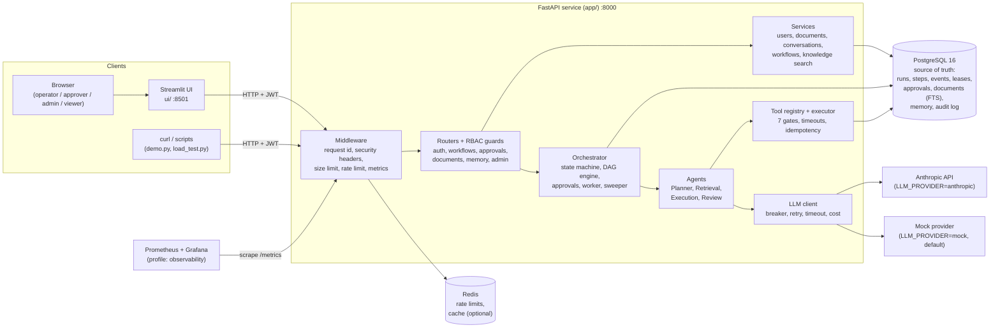

# High-level architecture

Who talks to whom, at the level you would draw on a whiteboard. Everything a user does goes
through the REST API; the web UI has no database access.

**Reading guide**

- The orchestrator is the only component that changes a run's state, and it does so through one
  store that writes the new state and a timeline event in the same database transaction.
- Agents never call each other; the orchestrator calls them in order and passes typed objects.
- Redis is optional: without `REDIS_URL` the rate limiter and caches run in-process.
