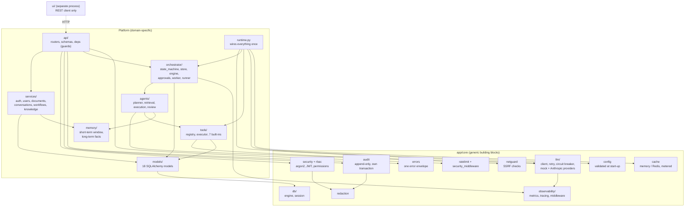

# Component diagram (inside the API process)

Arrows read "depends on / calls". `app/core/` is generic (no workflow vocabulary) and could be
lifted into another service unchanged; everything outside it is specific to this platform.

