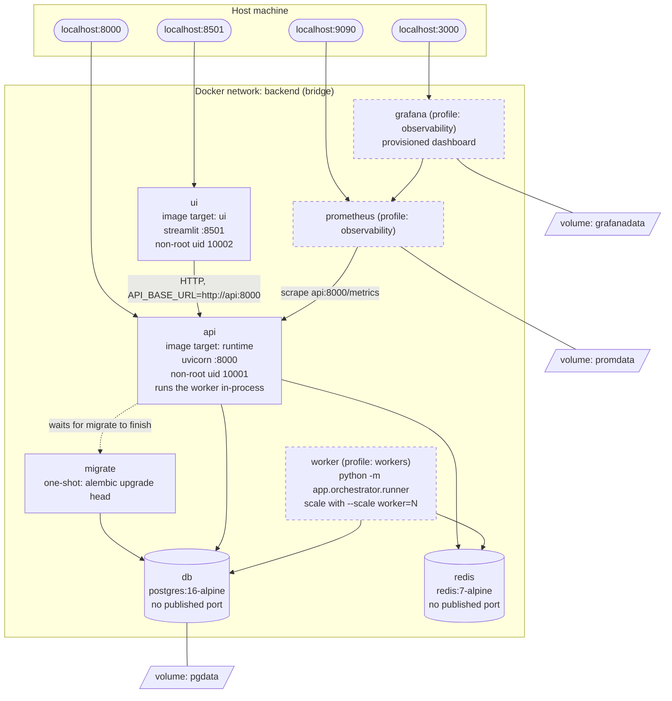

# Deployment diagram (Docker Compose)

`docker compose up --build` starts the solid boxes. Dashed boxes are opt-in profiles.

| Service | Image / target | Port | Notes |
|---|---|---|---|
| `db` | `postgres:16-alpine` | none published | Only containers on `backend` can reach it. Volume `pgdata`. |
| `redis` | `redis:7-alpine` | none published | Rate-limit counters and cache. |
| `migrate` | `runtime` | none | Runs `alembic upgrade head`, then exits; `api` waits for it. |
| `api` | `runtime` | 8000 | Non-root, health check on `/healthz`. |
| `ui` | `ui` (separate, no API dependencies) | 8501 | Starts after `api` is healthy. |
| `worker` | `runtime` | none | Optional extra orchestrators; set `WORKER_ENABLED=false` on the API. |
| `prometheus`, `grafana` | upstream images | 9090, 3000 | Dashboard and datasource are provisioned from `deploy/`. |
