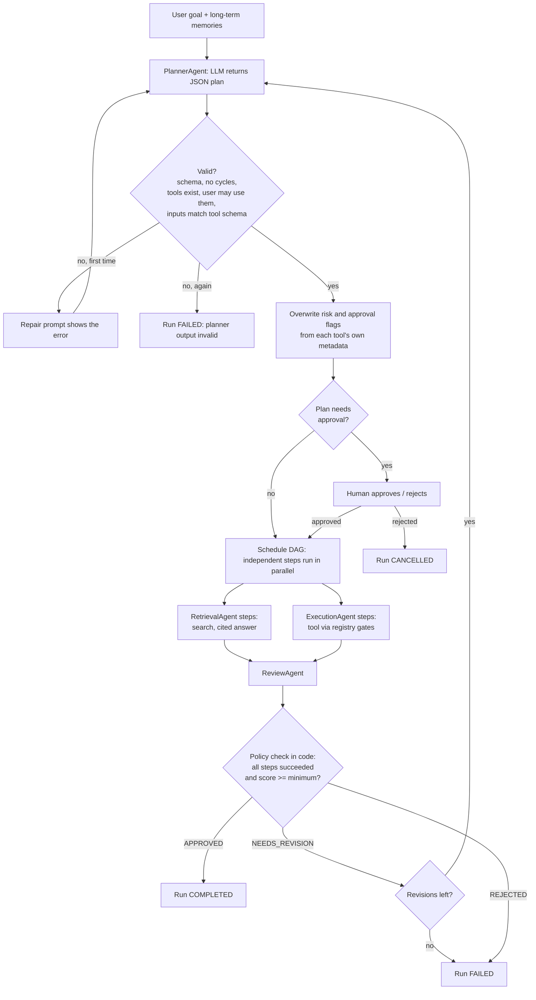

# Flowchart: how the four agents fit together

The orchestrator (Phase 5) drives this pipeline; each box is an agent or a check in code.

| Agent | Tools it may call | Why |
|---|---|---|
| Planner | none | planning must have no side effects |
| Retrieval | `search_knowledge_base` | read-only |
| Execution | the seven built-in tools, **only those in the approved plan** | the plan, not the model, decides |
| Review | none | an independent reviewer cannot act |
