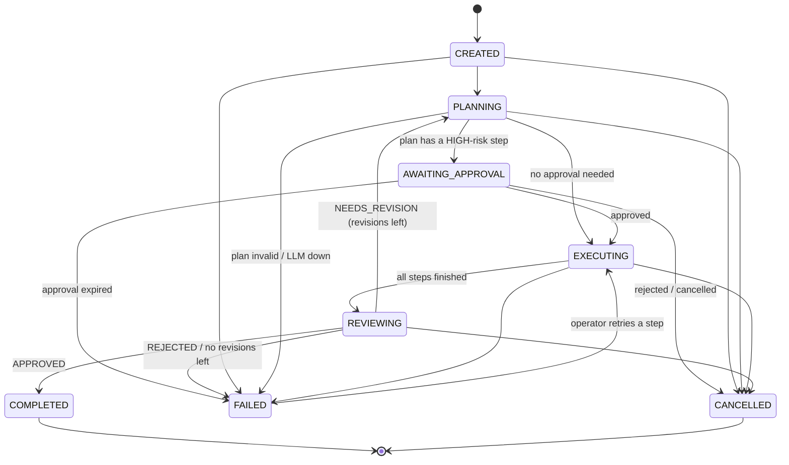
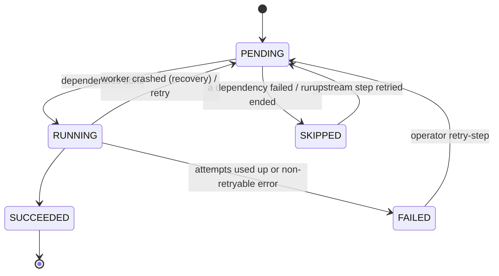

# Flowchart: run and step state machines

Source of truth: `app/orchestrator/state_machine.py`. Any other transition raises
`InvalidTransitionError`, and every legal one is written to `run_events` in the same transaction.

## Run

## Step

