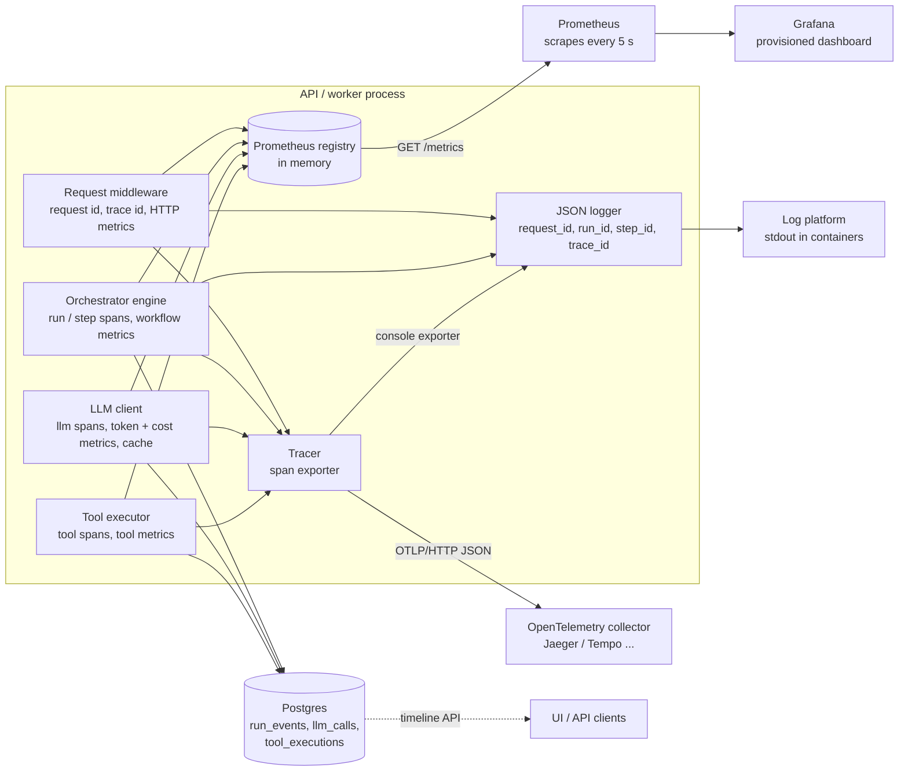

# Observability: metrics, traces and logs

How the three signals connect:

| Question | Where to look | How it links |
|---|---|---|
| "Is the system healthy right now?" | Grafana / `/metrics` | route templates, statuses, tool and breaker names as labels - never ids |
| "What happened in run X?" | `GET /workflows/{id}/timeline` (database) | steps, redacted tool I/O, LLM tokens/cost, events; the audit trail |
| "Where did the time go in run X?" | spans, `trace_id` = the run id without dashes | `workflow.run` > `agent.*` > `step.run` > `tool.*` / `llm.*` |
| "What did request R do?" | logs filtered by `request_id` | the response header `X-Request-ID`; `traceparent` is honoured so a caller's trace continues |

Why metrics, the timeline and traces are separate: metrics are cheap and aggregate (they answer
*how many / how slow* and must stay low-cardinality); the timeline is durable business data that
the product itself shows to users; traces are an operator's debugging aid and may be sampled or dropped
without losing anything that matters.
