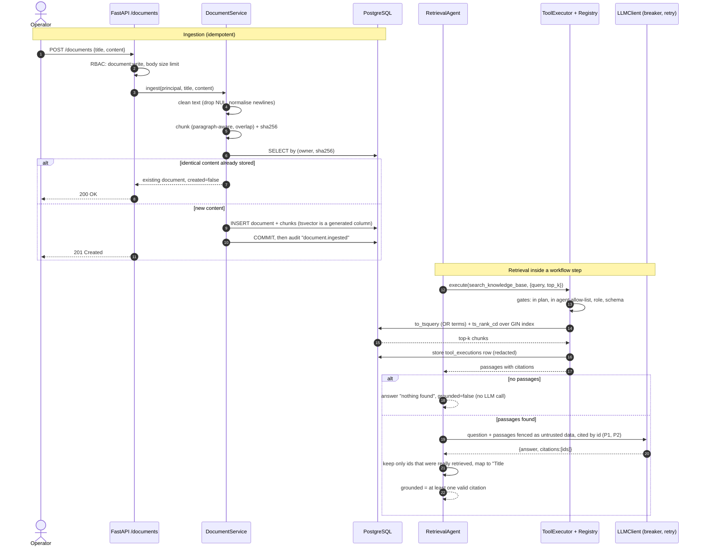

# Sequence: document ingestion and retrieval

**Why these choices**

- Ingestion de-duplicates on a content hash, enforced by a unique index, so a retried upload
  cannot crowd search results with duplicate chunks.
- Search runs through the tool layer, not directly: the same gates, audit and timeline apply to
  retrieval as to every other action.
- Passages are untrusted: they are fenced, the model is told never to follow instructions inside
  them, and its citations are verified against what was actually retrieved.
